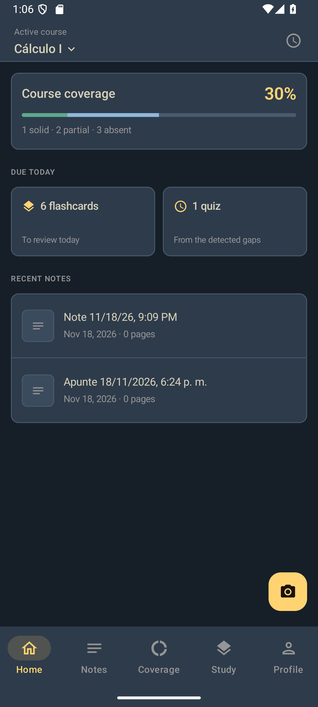
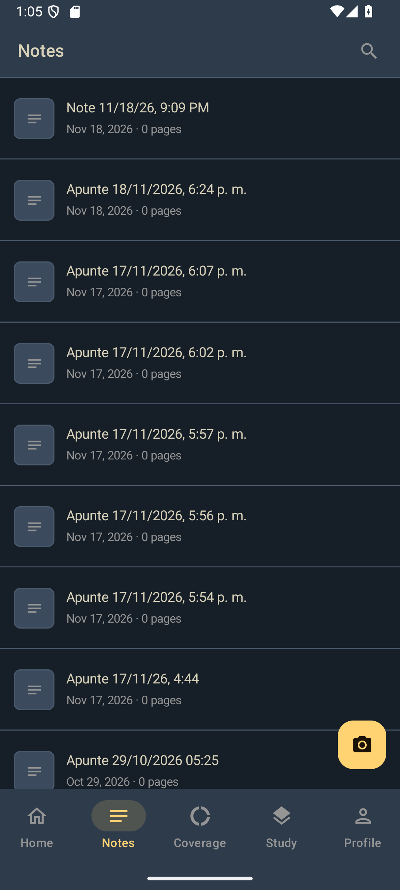
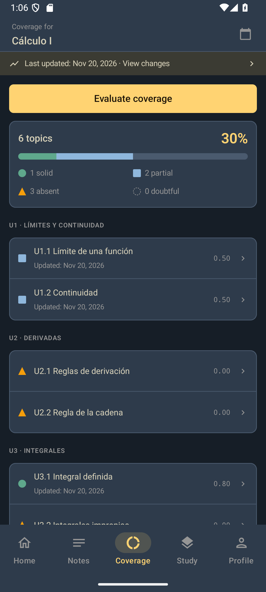
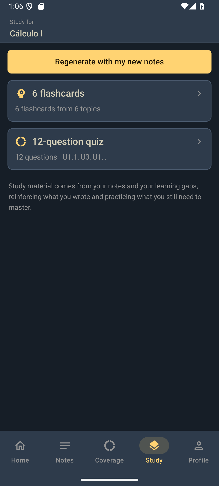

<div align="center">

# Glifo

**Convierte apuntes manuscritos en conocimiento estructurado, detecta qué falta frente al temario y arma tu repaso.**

[](https://github.com/Bloodiewormer/Proyecto-Plataformas-Moviles/releases/latest)
[](LICENSE)


[Descargar APK](https://github.com/Bloodiewormer/Proyecto-Plataformas-Moviles/releases/latest) · [Guía de despliegue](docs/Guia_Despliegue.md) · [Prototipo interactivo](https://bloodiewormer.github.io/Proyecto-Plataformas-Moviles/)

</div>

<table>
  <tr>
    <td align="center"><br><sub>Inicio</sub></td>
    <td align="center"><br><sub>Apuntes</sub></td>
    <td align="center"><br><sub>Cobertura del temario</sub></td>
    <td align="center"><br><sub>Estudio</sub></td>
  </tr>
</table>

## Qué hace

- **Captura y reconstruye.** Le tomás foto a tus apuntes. La app revisa la calidad, segmenta texto, fórmulas y figuras, y los reconstruye con LaTeX.
- **Muestra la confianza de cada fragmento.** Cada parte del apunte indica si se verificó, se reparó o es dudosa, y la podés corregir a mano.
- **Mide la cobertura del temario.** Compara tus apuntes con el syllabus del curso y marca cada tema como sólido, parcial o ausente.
- **Arma el repaso.** Genera flashcards y quizzes a partir de los temas que te faltan.
- **Funciona sin conexión.** Las capturas quedan en una cola local y se sincronizan cuando vuelve la red, sin duplicar páginas.
- **Tiene un rol para cada persona.** Los estudiantes capturan y estudian. Los docentes publican el temario y ven las brechas del grupo. El admin gestiona usuarios, roles y el consumo de IA.

## Principio de diseño

> **La IA no debe hacer todo.**

Todo lo que se puede resolver en el teléfono se resuelve ahí, de forma determinística, con OpenCV, ML Kit, reglas y hash perceptual. Un modelo de lenguaje entra solo en los casos que quedan ambiguos, y su resultado se guarda para no volver a pagarlo. La pantalla de uso de IA muestra cuántas llamadas se hicieron y cuántas se evitaron.

```
Foto ─► N0 calidad ─► N1 OCR local (ML Kit) ─► N1.5 OCR matemático ─► N2 reparación con visión ─► IA-01 reconstrucción
          en el teléfono     resuelve la mayoría      solo fórmulas            solo regiones dudosas
```

## Estructura

```
.
├── android/    App Android: Kotlin, Jetpack Compose, Hilt, Room, WorkManager, CameraX, ML Kit, OpenCV
├── backend/    API REST: Spring Boot en Kotlin, PostgreSQL (JSONB), JWT, Dockerfile para Render
├── docs/       Alcance, arquitectura, decisiones, UML, guía de despliegue y experimentos de OCR
├── prototype/  Prototipo interactivo (React + Vite), publicado en GitHub Pages
└── scripts/    Utilidades de desarrollo (levantar PostgreSQL local)
```

## Empezar

**Probar la app:** descargá el APK del [último release](https://github.com/Bloodiewormer/Proyecto-Plataformas-Moviles/releases/latest). Usa el backend público en Render. Si estuvo inactivo, el primer inicio de sesión puede tardar un minuto.

**Correr todo en tu máquina:**

```powershell
.\scripts\db-up.ps1                 # PostgreSQL en Docker
cd backend; .\gradlew.bat bootRun   # API en http://localhost:8080/api/v1/
```

Después abrí `android/` en Android Studio y corré el build **debug** en un emulador, que ya apunta al backend local.

La [guía de despliegue](docs/Guia_Despliegue.md) explica cómo publicar el backend en Render con Neon, conectar un teléfono físico, cambiar la URL del APK y firmar y publicar versiones nuevas.

## Stack

| Capa | Tecnologías |
|---|---|
| Android | Kotlin, Jetpack Compose (Material 3), Hilt, Room, WorkManager, Retrofit, CameraX, ML Kit Text Recognition, OpenCV, KaTeX, Firebase Crashlytics y FCM |
| Backend | Spring Boot 4 en Kotlin, Spring Security con JWT, JPA/Hibernate, PostgreSQL con JSONB |
| IA | OpenAI (`gpt-4o-mini`) para reconstrucción, OCR matemático, material de estudio y adjudicación de cobertura |
| Infraestructura | Render (Docker), Neon (PostgreSQL), GitHub Pages (prototipo) |

## Documentación

| Documento | Contenido |
|---|---|
| [Guía de despliegue](docs/Guia_Despliegue.md) | Backend local y en Render, conexión del APK, firma y releases |
| [Alcance](docs/Glifo_Alcance.md) | Funcionalidad, flujo de procesamiento y funciones de IA |
| [Diseño de arquitectura](docs/Glifo_Diseno_Arquitectura.md) | Visión general de la arquitectura |
| [Estándares](docs/Glifo_Arquitectura_Estandares.md) | Capas, convenciones y tokens de diseño |
| [Bitácora de decisiones](docs/Glifo_Bitacora_Decisiones.md) | Decisiones tomadas y su porqué |
| [Modelado UML](docs/Glifo_UML_Modeling.md) | Diagramas de clases, secuencia y despliegue |
| [Backend](backend/README.md) | API, contrato con la app y base de datos |
| [Android](android/README.md) | Arquitectura de la app |
| [Experimentos de OCR](docs/experimentos/) | Evaluación de modelos de OCR matemático (TexTeller, Pix2Text) |

## Historia

Glifo nació como proyecto del curso EIF411 Diseño y Programación de Plataformas Móviles de la Universidad Nacional de Costa Rica, en 2026. Lo hizo el Grupo X-Ray: Brandon Brenes, David González y Felipe Ugalde. Este repositorio reúne el backend y la app con el historial completo de los repositorios del curso, y el proyecto sigue como proyecto personal.

## Licencia

[MIT](LICENSE)
